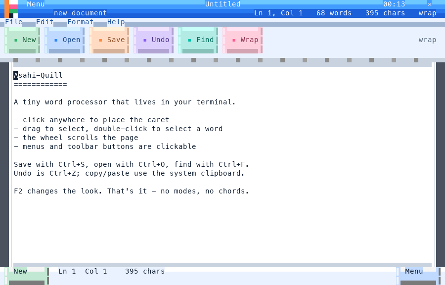
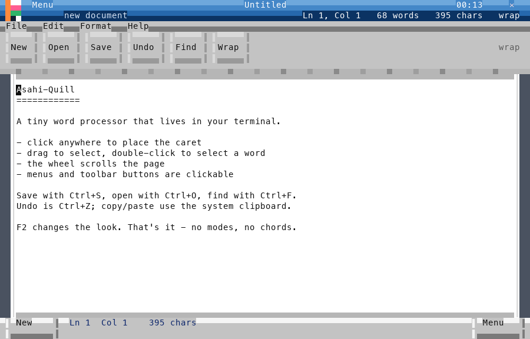
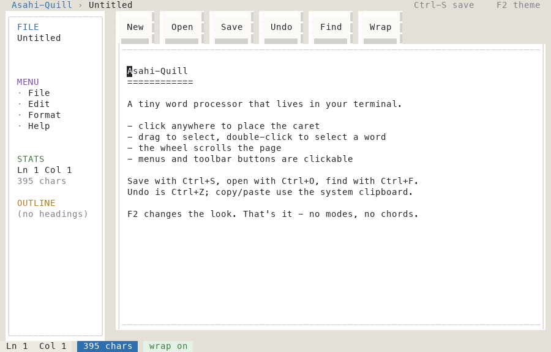
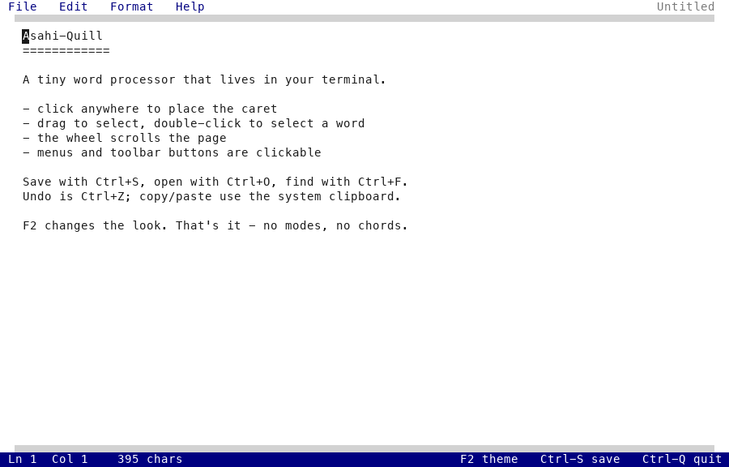

# Asahi-Quill


A mouse-first text editor that runs in your terminal — click to place the caret,
drag to select, scroll with the wheel. Every piece of chrome (menu bar, toolbar,
status line, dialogs) is drawn by hand out of half-block characters, so it looks
like a 1990s GUI instead of a 1970s one. No modes, no chords, no vim bindings.



## Run

```bash
./asahi-quill.command              # demo document
./asahi-quill.command notes.txt    # open a file
python3 asahi-quill.py --theme pocket
```

Plain Python 3.9+, standard library only. A terminal of at least 60×20 works;
100×32 or larger is comfortable.

## Controls

| What | How |
|---|---|
| Place the caret | click anywhere on the page |
| Select | drag; double-click picks a word |
| Scroll | mouse wheel |
| Save / open / find | `Ctrl-S` / `Ctrl-O` / `Ctrl-F` |
| Undo / select all | `Ctrl-Z` / `Ctrl-A` |
| Copy / cut / paste | `Ctrl-C` / `Ctrl-X` / `Ctrl-V` (uses `pbcopy` / `pbpaste`) |
| Cycle themes | `F2` |
| Quit | `Ctrl-Q` or the ✕ in the title bar (warns if unsaved) |

## Themes

Five skins, cycled with `F2` and remembered in `.theme`:

| theme | look |
|---|---|
| `vivid` (default) | WM-style bevels with a bright palette: blue title bar, one hue per toolbar button |
| `pocket` | classic silver WM2003 bevels |
| `studio` | card layout: sidebar (file / menu / stats / outline), bevel toolbar, floating page |
| `next` | flat: solid title bar, 1px rules, a single accent colour |
| `paper` | WordPerfect 5.1: no title bar, one menu row, a blue status line |

| pocket | studio | paper |
|---|---|---|
|  |  |  |

## How it works

* **A cell is two pixels.** `U+2580` paints the top half with the foreground
  colour and the bottom half with the background, which is what makes 1px
  bevels and gradient title bars possible.
* **Vertical rules are one cell wide.** A terminal cannot draw a thinner
  vertical line, so bevels and frames are built from `▌` / `▐` / `│` instead.
* **No newlines in the output.** The app runs in raw mode, where `\n` does not
  return the carriage; the frame is emitted with absolute cursor addressing
  (`CSI row;1H`) and verified cell by cell by `verify_ansi.py`.
* **CJK aware.** Wide characters occupy two cells; wrapping, the caret and
  selection all use display width, and the cell after a wide character is
  skipped when emitting.

## Tests

`tests/verify_ansi.py` replays the emitted frame through a small terminal
emulator (CUP, SGR, erase, DECAWM pending-wrap, wide characters) and compares
it with the canvas cell by cell -- the class of bug you cannot see by looking:

```bash
python3 tests/verify_ansi.py     # 9/9 passed
```

## Files

```
asahi-quill.py      the editor (single file)
termui.py           canvas: half blocks, true colour, absolute output
themes.py           the five skins
assets/             icon.svg and PNG exports
shots/              screenshots used in this README
tests/verify_ansi.py frame-accurate replay test
```

The logo is drawn at 8×4 sub-pixels inside the title bar; `assets/icon.svg`
is the same motif at vector size.

## Limitations

* Plain text: no bold/italic runs, no syntax highlighting
* One document at a time
* `--png` previews need Pillow; running the editor does not

## License

MIT — see [LICENSE](LICENSE).
